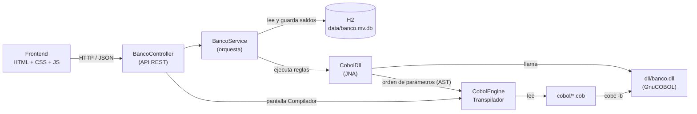
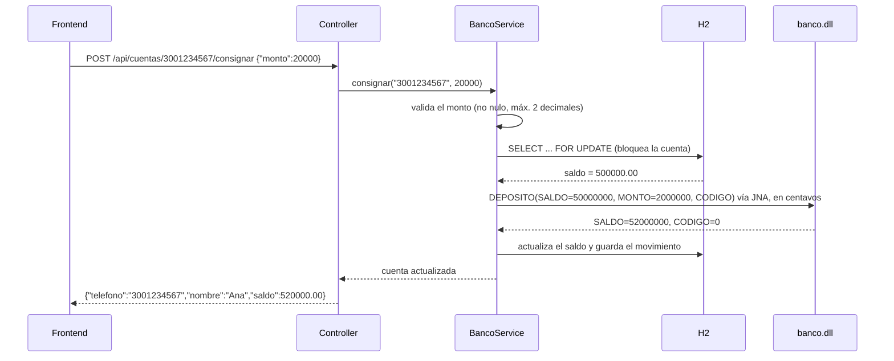

# Arquitectura

## Las piezas

| Pieza | Dónde está | Qué hace |
|---|---|---|
| Frontend | `src/main/resources/static/` | Las pantallas. Spring las sirve en `/`. |
| API REST | `cuenta/BancoController.java` | Recibe las peticiones HTTP y convierte los errores en JSON. |
| Servicio | `cuenta/BancoService.java` | Valida los datos, bloquea las cuentas, llama al COBOL y guarda los resultados. |
| Persistencia | `cuenta/Cuenta.java`, `Movimiento.java`, `Repositorios.java` | Tablas `CUENTA` y `MOVIMIENTO` en H2, usadas con JPA. |
| Puente a la DLL | `cobol/CobolDll.java` | Llama con JNA a las funciones de `banco.dll` y convierte los saldos de ida y vuelta. Ver [dll.md](dll.md). |
| Transpilador | `cobol/CobolEngine.java` y fases | Lee los `.cob`, arma el AST y genera el Java equivalente (pantalla Compilador y pruebas). |
| Programas COBOL | `src/main/resources/cobol/` | Las reglas del dinero: `APERTURA`, `CONSULTA`, `DEPOSITO`, `RETIRO`, `TRANSFERENCIA`. Compilados en `dll/banco.dll`. |

La regla para repartir el trabajo es esta: **Java decide *cómo* se guarda el dinero y COBOL decide
*qué* pasa con el saldo.** El servicio no hace sumas ni restas. Le pasa los saldos al programa COBOL
y guarda lo que el programa devuelva.

| Acción del usuario | Programa de la DLL |
|---|---|
| Crear cuenta (con saldo inicial opcional) | `APERTURA` |
| Ver la cuenta / el saldo | `CONSULTA` |
| Consignar | `DEPOSITO` |
| Retirar | `RETIRO` |
| Transferir | `TRANSFERENCIA` |

## Recorrido de una consignación

Ejemplo: Ana consigna $20.000.

1. El frontend manda el monto.
2. El servicio revisa que el monto tenga sentido como número.
3. Bloquea la fila de la cuenta en la base de datos para que nadie más la cambie mientras tanto.
4. Llama a la función `DEPOSITO` de `banco.dll` con el saldo actual y el monto (en centavos, ver [dll.md](dll.md)).
5. El programa responde con el nuevo saldo y un **CODIGO**:
   - `0`: todo bien.
   - `1`: monto inválido → HTTP 400.
   - `2`: fondos insuficientes → HTTP 422.
   - `3`: saldo inconsistente (solo `CONSULTA`) → HTTP 409.
6. Si el código es 0, se guarda el nuevo saldo y se registra el movimiento. Si el código es otro, se
   lanza un error, la transacción se deshace y no cambia nada.

Retirar funciona igual con el programa `RETIRO`. Transferir usa `TRANSFERENCIA`, que recibe los dos
saldos (origen y destino) y devuelve los dos ya actualizados.

## Por qué el saldo no se pierde

- La base H2 está configurada **en archivo** (`spring.datasource.url=jdbc:h2:file:./data/banco`),
  no en memoria. Todo lo que se guarda queda en `data/banco.mv.db`.
- Cada operación es una **transacción** (`@Transactional`): o se guarda todo (saldo y movimiento),
  o no se guarda nada.
- Las tablas se crean solas la primera vez (`ddl-auto=update`). Las cuentas de prueba solo se crean
  si la base está vacía.

## Dos operaciones al mismo tiempo

Si dos peticiones llegan a la vez sobre la misma cuenta, las dos podrían leer el mismo saldo y una
pisaría a la otra. Para evitarlo, el servicio lee la cuenta con un **bloqueo pesimista**
(`SELECT ... FOR UPDATE`): la segunda petición espera hasta que la primera termine.

En una transferencia se bloquean **dos** cuentas. Siempre se bloquean en el mismo orden (primero el
teléfono menor) para que dos transferencias cruzadas (A→B y B→A) no se queden esperándose una a la
otra para siempre (*deadlock*).

## Timeouts

Ninguna operación se puede quedar esperando para siempre:

| Dónde | Límite | Qué pasa al vencerse |
|---|---|---|
| Frontend, cada petición (`app.js`, `TIMEOUT_PETICION_MS`) | 8 s | Se cancela con `AbortController` y se muestra "El servidor no respondió en 8 s". Si era una operación de dinero, se pide revisar los movimientos antes de repetirla, porque el servidor pudo haberla completado. |
| Frontend, sesión (`INACTIVIDAD_MS`) | 2 min sin actividad | A los 1:30 aparece un aviso con cuenta regresiva de 30 s y el botón "Seguir conectado". Si nadie responde, la sesión se cierra y el ingreso muestra "Tu sesión se cerró por inactividad". Cualquier clic o tecla reinicia el conteo. |
| Base de datos (`LOCK_TIMEOUT=5000`) | 5 s | Si otra operación tiene bloqueada la cuenta más tiempo, la operación falla en vez de quedarse esperando. |
| Transacción (`spring.transaction.default-timeout`) | 10 s | La transacción se deshace y no se guarda nada. |

## Frontend

Son tres archivos (`index.html`, `app.css`, `app.js`) sin frameworks y sin paso de compilación.

- **Ingreso / registro**: con el teléfono. Al registrarse se puede dar un saldo inicial. La sesión se recuerda en `localStorage` y se cierra sola por inactividad.
- **Inicio**: el saldo, los botones de acción y los últimos movimientos.
- **Consignar / Retirar / Transferir**: formularios que validan antes de enviar y muestran el error que devuelva el servidor.
- **Compilador**: muestra el `.cob` y el Java generado lado a lado.

Los íconos son SVG escritos a mano. No hay animaciones ni librerías externas, para que cargue rápido.
