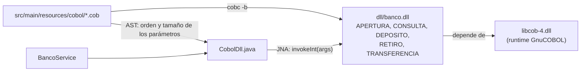

# La DLL de operaciones COBOL

Las cinco operaciones bancarias viven en una sola librería dinámica de Windows, **`dll/banco.dll`**,
compilada con **GnuCOBOL**. Java no lleva copia de las reglas del dinero: cada vez que hay que mover
un saldo, llama a la función correspondiente dentro de la DLL usando **JNA** (Java Native Access).



## Compilarla

1. Instalar GnuCOBOL desde una consola de MSYS2:

   ```bash
   pacman -S mingw-w64-x86_64-gnucobol
   ```

2. Desde la raíz del proyecto, en PowerShell:

   ```powershell
   .\compilar-dll.ps1
   ```

   El script ejecuta `cobc -b -free -o dll/banco.dll src/main/resources/cobol/*.cob`.
   - `-b` arma **un solo módulo** con todos los programas: cada `PROGRAM-ID` queda como una función
     exportada de la DLL.
   - `-free` es el formato libre, sin columnas fijas.
   - El script agrega `C:\msys64\mingw64\bin` al `PATH` (cobc necesita `gcc`) y define
     `COB_CONFIG_DIR`. Si MSYS2 está en otra carpeta: `.\compilar-dll.ps1 -Runtime D:\msys64\mingw64\bin`.

La DLL es un archivo generado, así que no se sube al repositorio (`dll/` está en `.gitignore`).
Cada vez que se cambia un `.cob` hay que volver a correr el script y reiniciar la app.

## Cómo es un programa que se puede llamar desde la DLL

Un programa COBOL "principal" lee sus datos de `WORKING-STORAGE` y termina con `STOP RUN`. Uno que
se llama desde afuera necesita tres cambios, y los cinco `.cob` del proyecto ya los tienen:

```cobol
DATA DIVISION.
LINKAGE SECTION.                                  *> 1. los datos llegan por referencia
01 SALDO   PIC S9(12)V99 COMP-5.                  *> 2. formato binario nativo
01 MONTO   PIC S9(12)V99 COMP-5.
01 CODIGO  PIC S9(9)     COMP-5.

PROCEDURE DIVISION USING SALDO MONTO CODIGO.      *> orden de los parámetros
    ...
    GOBACK.                                       *> 3. vuelve a quien llamó
```

1. **`LINKAGE SECTION` + `PROCEDURE DIVISION USING`**: las variables no son del programa, son
   punteros a memoria que pone quien llama. Si COBOL cambia `SALDO`, Java ve el cambio.
2. **`COMP-5`**: el número se guarda como un entero binario de la máquina, igual que un `long` o un
   `int` de Java. `PIC S9(12)V99 COMP-5` ocupa 8 bytes y guarda el valor **multiplicado por 100**
   (la `V99` son 2 decimales implícitos): $5.000,25 viaja como el entero `500025`.
   `PIC S9(9) COMP-5` ocupa 4 bytes.
3. **`GOBACK` en vez de `STOP RUN`**: `STOP RUN` dentro de una DLL terminaría **todo el proceso**,
   o sea, apagaría el servidor Java. `GOBACK` solo devuelve el control.

`DISPLAY` de una variable `COMP-5` la imprime sin punto decimal (`+00000000000000500025`). Por eso
los programas copian el saldo a `SALDO-VER`, una variable normal de `WORKING-STORAGE`, antes de mostrarlo.

## Cómo la llama Java (`cobol/CobolDll.java`)

Al arrancar la app:

1. Carga `libcob-4.dll` por ruta absoluta (`banco.cobol.runtime`) y llama a `cob_init`, que inicia
   el runtime de GnuCOBOL. Como libcob ya está cargada, Windows la reutiliza al abrir `banco.dll`.
2. Carga `banco.dll` (`banco.cobol.dll`). Si no existe, la app no arranca y el mensaje dice que hay
   que correr `compilar-dll.ps1`.

En cada operación, `ejecutar("DEPOSITO", {SALDO: 5000, MONTO: 250.75})`:

1. Lee el AST del mismo `DEPOSITO.cob` (lo arma el parser del transpilador) para saber **el orden**
   de `USING` y **el tamaño** de cada parámetro según su `PIC`.
2. Reserva un bloque de memoria nativa (`Memory`) por parámetro y escribe el valor como entero
   escalado: `5000.00 → 500000L`.
3. Llama a la función: `dll.getFunction("DEPOSITO").invokeInt(args)`.
4. Lee los bloques de vuelta y los convierte otra vez en `BigDecimal`: `525075L → 5250.75`.

Así, agregar un programa nuevo no requiere escribir una interfaz JNA a mano: basta con el `.cob`,
recompilar la DLL y agregarlo a la lista de `CobolEngine`.

El método es `synchronized`: el runtime de GnuCOBOL no está pensado para varios hilos a la vez,
así que las llamadas a la DLL se hacen de una en una. Para una app de este tamaño no se nota.

## Configuración

En `application.properties`:

```properties
banco.cobol.dll=./dll/banco.dll
banco.cobol.runtime=C:/msys64/mingw64/bin
```

## ¿Y el transpilador?

Los mismos `.cob` siguen pasando por el transpilador (lexer → parser → AST → Java). Con él:

- la pantalla **Compilador** muestra el COBOL al lado del Java equivalente;
- `CobolDll` obtiene del AST el orden y el tipo de los parámetros;
- `CobolEngineTest` prueba las reglas sin necesitar GnuCOBOL.

El dinero de verdad, en cambio, siempre se mueve con la DLL. `CobolDllTest` llama a las cinco
operaciones en la DLL real (se omite si todavía no se ha compilado).
