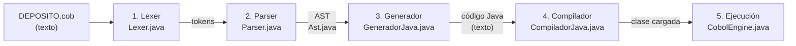

# El transpilador COBOL → Java

Todo el código está en `src/main/java/co/edu/uptc/banco/cobol/`. Cada fase está en su propio archivo,
como en un compilador de libro:



| Fase | Entrada | Salida | Tema de la materia |
|---|---|---|---|
| 1. Análisis léxico | texto | lista de tokens | lenguajes regulares, autómatas finitos |
| 2. Análisis sintáctico | tokens | árbol (AST) | gramáticas libres de contexto, parser descendente recursivo |
| 3. Generación de código | AST | texto Java | traducción dirigida por la sintaxis |
| 4. Compilación | texto Java | bytecode en memoria | (el trabajo lo hace `javac`) |
| 5. Ejecución | bytecode + saldos | saldos nuevos | |

Las fases 1 a 4 se hacen **una sola vez por programa**. El resultado queda guardado en caché y de ahí
en adelante cada consignación solo ejecuta la clase ya compilada.

Se usa como ejemplo esta línea de `DEPOSITO.cob`:

```cobol
    ADD MONTO TO SALDO
```

---

## Fase 1: Lexer (análisis léxico)

El lexer lee el texto carácter por carácter y lo agrupa en **tokens**, que son las "palabras" del
lenguaje. Se salta los espacios y los comentarios (`*> ...`).

```
ADD MONTO TO SALDO
→ [PALABRA "ADD"] [PALABRA "MONTO"] [PALABRA "TO"] [PALABRA "SALDO"]

01 SALDO PIC S9(12)V99 VALUE 0.
→ [NUMERO "01"] [PALABRA "SALDO"] [PALABRA "PIC"] [PIC "S9(12)V99"] [PALABRA "VALUE"] [NUMERO "0"] [PUNTO]
```

Tipos de token: `PALABRA`, `NUMERO`, `CADENA` (`'texto'`), `PIC`, `SIMBOLO` (`+ - * / = < > <= >= ( )`), `PUNTO` y `FIN`.

Casos en los que el lexer tiene que fijarse:

- **El guion.** En `SALDO-ORIGEN` el guion es parte del nombre, porque está pegado a letras. En
  `A - B` es una resta. La regla: un guion seguido de letra o dígito sigue siendo parte de la palabra.
- **El punto.** En `0.50` es un decimal y en `VALUE 0.` termina la sentencia. Solo se toma como
  decimal si le sigue un dígito.
- **La máscara PIC.** Después de la palabra `PIC`, el texto `S9(12)V99` se lee como un solo token y
  se valida con la expresión regular `S?9+(\(\d+\))?(V9+(\(\d+\))?)?`. Es un ejemplo directo de
  lenguaje regular.
- Todas las palabras se pasan a **mayúsculas**, porque COBOL no distingue mayúsculas de minúsculas.

Cada token guarda su **número de línea**, para que los errores digan dónde ocurrieron.

## Fase 2: Parser (análisis sintáctico)

El parser revisa que los tokens sigan la **gramática** del lenguaje y construye un árbol. Es un
parser **descendente recursivo**: cada regla de la gramática es un método de Java que llama a los
métodos de las reglas que contiene.

### La gramática (en notación BNF)

```
programa    ::= IDENTIFICATION DIVISION . PROGRAM-ID . nombre .
                DATA DIVISION . WORKING-STORAGE SECTION . variable*
                PROCEDURE DIVISION . sentencia*
variable    ::= nivel nombre PIC mascara [VALUE ['-'] numero] .
sentencia   ::= (move | add | subtract | compute | if | display | STOP RUN) ['.']
move        ::= MOVE factor TO variable
add         ::= ADD factor TO variable
subtract    ::= SUBTRACT factor FROM variable
compute     ::= COMPUTE variable = expr
if          ::= IF condicion [THEN] sentencia* [ELSE sentencia*] END-IF
display     ::= DISPLAY (cadena | numero | variable)+
condicion   ::= condY (OR condY)*
condY       ::= comparacion (AND comparacion)*
comparacion ::= expr [NOT] ('>' | '<' | '=' | '>=' | '<=') expr
expr        ::= termino (('+' | '-') termino)*
termino     ::= factor (('*' | '/') factor)*
factor      ::= numero | variable | '-' factor | '(' expr ')'
```

Cosas que se pueden señalar en clase:

- **Precedencia de operadores.** Está metida en la gramática misma: `expr` → `termino` → `factor`.
  Por eso `A + B * C` se lee como `A + (B * C)` sin que el código tenga reglas especiales. Lo mismo
  pasa con `AND`, que tiene más prioridad que `OR`.
- **Recursión.** `if` contiene `sentencia*`, y una de esas sentencias puede ser otro `if`. Por eso los
  `IF` anidados funcionan sin código adicional. Esta anidación es justamente lo que una expresión
  regular no puede reconocer y una gramática libre de contexto sí.
- **Un token de anticipación.** Para decidir qué regla seguir, al parser le basta con mirar el token
  actual. Si es `MOVE`, va por `move`; si es `IF`, va por `if`.
- **Análisis semántico.** El parser también lleva una tabla de símbolos con las variables declaradas.
  Si una sentencia usa una variable que no existe, da error antes de generar código.

### El árbol (AST)

`Ast.java` define los nodos como `record` de Java. Para `ADD MONTO TO SALDO`, el parser produce:

```
Add
├── valor:   Var("MONTO")
└── destino: "SALDO"
```

Para `IF MONTO <= 0 ... ELSE ... END-IF`:

```
If
├── condicion: Comparacion(Var("MONTO"), "<=", Numero("0"))
├── entonces:  [Move(Numero("1"), "CODIGO"), Display(...)]
└── sino:      [Add(Var("MONTO"), "SALDO"), Move(...), Display(...)]
```

## Fase 3: Generador de Java

El generador **recorre el árbol** y escribe una línea de Java por cada nodo. Usa `switch` con
*pattern matching* sobre los tipos de nodo:

| Nodo | Java que escribe |
|---|---|
| `Add(MONTO, SALDO)` | `SALDO = SALDO.add(MONTO).setScale(2, HALF_EVEN);` |
| `Comparacion(MONTO, "<=", 0)` | `MONTO.compareTo(new BigDecimal("0")) <= 0` |
| `Binaria('/', A, B)` | `A.divide(B, 2, HALF_EVEN)` |
| `StopRun` | `break programa;` |

Resultado para `DEPOSITO.cob` (lo mismo que muestra la pantalla Compilador de la app):

```java
public class Cobol_DEPOSITO implements Consumer<Map<String, BigDecimal>> {

    @Override
    public void accept(Map<String, BigDecimal> memoria) {
        // WORKING-STORAGE SECTION
        BigDecimal SALDO = leer(memoria, "SALDO", "0"); // PIC S9(12)V99
        BigDecimal MONTO = leer(memoria, "MONTO", "0"); // PIC S9(12)V99
        BigDecimal CODIGO = leer(memoria, "CODIGO", "0"); // PIC 9

        // PROCEDURE DIVISION (STOP RUN = break programa)
        programa: {
            if (MONTO.compareTo(new BigDecimal("0")) <= 0) {
                CODIGO = new BigDecimal("1").setScale(2, RoundingMode.HALF_EVEN);
                System.out.println("DEPOSITO RECHAZADO: MONTO INVALIDO");
            } else {
                SALDO = SALDO.add(MONTO).setScale(2, RoundingMode.HALF_EVEN);
                CODIGO = new BigDecimal("0").setScale(2, RoundingMode.HALF_EVEN);
                System.out.println("DEPOSITO OK, NUEVO SALDO: " + SALDO.toPlainString());
            }
            break programa;
        }

        // Devuelve las variables al mapa
        memoria.put("SALDO", SALDO);
        memoria.put("MONTO", MONTO);
        memoria.put("CODIGO", CODIGO);
    }
    ...
}
```

Decisiones de diseño:

- **El mapa `memoria` es la "WORKING-STORAGE".** Las variables entran por el mapa, se trabajan como
  variables locales y salen de nuevo por el mapa. Así el banco y el COBOL se comunican sin conocer
  la clase del otro.
- **¿Por qué `STOP RUN` se traduce como `break programa;` y no como `return`?** Con `return` el
  método terminaría antes de devolver las variables al mapa. Con un bloque etiquetado y `break`,
  siempre se llega a los `memoria.put(...)` del final.
- El código que viene después de un `STOP RUN` no se genera, porque nunca se ejecutaría y `javac` lo
  rechazaría como "código inalcanzable".
- La clase generada solo usa tipos del JDK (`Consumer`, `Map`, `BigDecimal`), así que se compila sin
  depender de las clases de la aplicación.

## Fase 4: Compilación en memoria

`CompiladorJava.java` usa la API del compilador de Java (`javax.tools.JavaCompiler`), que es el mismo
`javac` pero llamado desde código:

1. El código Java generado se entrega como un "archivo" que en realidad está en memoria (`SimpleJavaFileObject`).
2. Un `JavaFileManager` propio intercepta el `.class` que produce `javac` y lo guarda en un arreglo
   de bytes en vez de escribirlo en disco.
3. Un `ClassLoader` propio convierte esos bytes en una clase (`defineClass`).
4. Se crea una instancia y se guarda en un `ConcurrentHashMap` (la caché).

Por eso la app necesita un **JDK** para correr: un JRE no incluye `javac`.

## Fase 5: Ejecución

```java
Map<String, BigDecimal> r = cobolEngine.ejecutar("DEPOSITO", Map.of("SALDO", saldo, "MONTO", monto));
r.get("SALDO");   // nuevo saldo
r.get("CODIGO");  // 0, 1 o 2
```

## Errores con número de línea

Si el COBOL tiene un error, el transpilador lanza una `CobolException` que dice la línea:

```
Error en la línea 7: se esperaba 'TO' pero se encontró 'SALDO'
Error en la línea 2: carácter inesperado '#'
Error en la línea 12: variable no declarada 'SALDOO'
```

Esto pasa la primera vez que se usa el programa, antes de tocar cualquier saldo.

## Pruebas

`src/test/java/.../cobol/CobolEngineTest.java` (13 pruebas, se corren con `mvn test`) cubre:

- cada programa en sus tres resultados: ok, monto inválido y fondos insuficientes;
- errores léxicos y sintácticos, revisando la línea que se reporta;
- un programa que no existe;
- que `SALDO-ORIGEN` se traduzca como `SALDO_ORIGEN`;
- `COMPUTE` con división y paréntesis.
